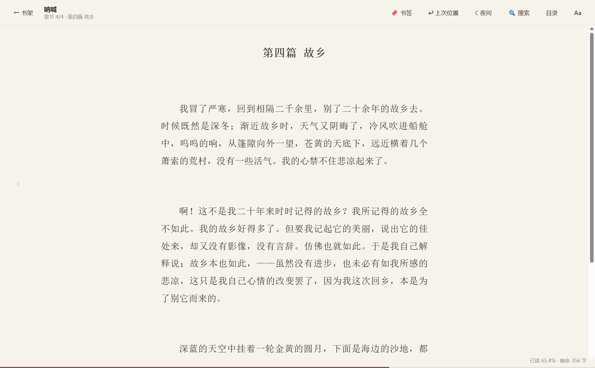
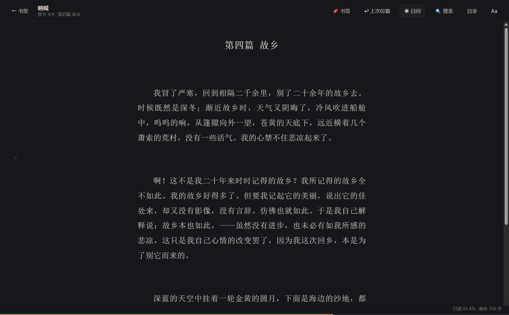
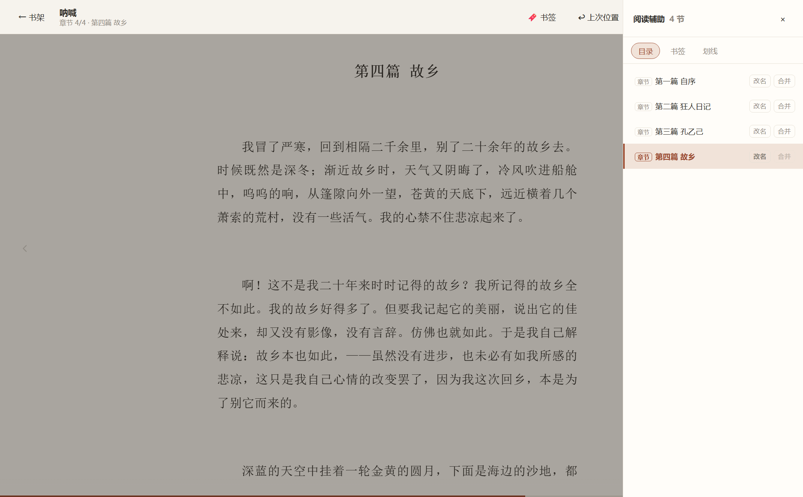

<div align="center">

# 📖 十二阅读

**一个本地优先的 Windows 桌面阅读器：把 TXT / EPUB / MOBI 拖进来，从头读到尾，关掉再打开回到原处。**

没有账号 · 没有服务器 · 不联网 —— 书和进度只存在这台电脑上

[](https://www.electronjs.org/)
[](#-功能特性)
[](#-功能特性)
[](../../releases/latest)


</div>

---

## ✨ 功能特性

- 📚 **三种格式** —— TXT / EPUB 2·3 / MOBI（MOBI6·KF7，无 DRM）直接拖进窗口；书名、作者、封面与正文插图都从书里读出来
- 📖 **沉浸阅读** —— 只渲染当前章，正文两侧悬浮箭头切章，键盘翻页（← / →、空格、PageUp / Down），目录抽屉高亮当前节
- 🔖 **书签与划线** —— 一键记位置、选中即划线；目录抽屉里每条带原文摘要，点一下跳回原处
- 🔍 **全书搜索** —— Ctrl + F 边打字边搜，「本章 / 全书」切换，命中带前后文，点击跳转并闪烁定位
- ↩️ **进度常记** —— 「上次位置」一键回跳、再点回到离开处；关掉重开一定停在原处，改字号换字体都不影响
- 🅰 **排版随心** —— 七款字体（宋体 / 仿宋 / 楷体 / 黑体 / 文楷 / 思源宋 / 中宋）、字号 15–56、行距字距步进微调、栏宽五档、加粗三档（不发虚）
- 🌙 **日间 / 夜间** —— 顶栏一键切换，整页连滚动条一起变，对比度按 WCAG 4.5:1 校准
- 📊 **阅读统计** —— 只统计「真在读」的时间：今天 / 累计 / 连续天数、近 14 天柱状图、日历热力视图、每日目标
- 🧩 **分章可修** —— 自动识别「第 N 章 / 卷 / 回」，认不出按字数分段并如实标注；目录里随时改名、合并，正文一字不动
- 🔤 **编码无忧** —— UTF-8 / GB18030 自动识别，二进制文件直接拒绝；乱码书在书卡上一键换 GBK / BIG5 / UTF-16 重解，不用重新导入
- 💾 **数据自主** —— 本地 SQLite 存储，一键导出整库备份 zip，不依赖任何云服务
- 🔄 **检查更新** —— 书架左下角静默检查，有新版出现一颗「去下载」胶囊（只提示，不自动下载）

## 📸 界面预览

<table>
  <tr>
    <td width="50%"><br><div align="center"><sub>日间阅读（宋体 · 中栏宽）</sub></div></td>
    <td width="50%"><br><div align="center"><sub>夜间模式</sub></div></td>
  </tr>
  <tr>
    <td width="50%"><br><div align="center"><sub>Aa 排版面板（字号 / 行距 / 字距 / 字体 / 主题）</sub></div></td>
    <td width="50%"><br><div align="center"><sub>目录抽屉（目录 / 书签 / 划线，可改名合并）</sub></div></td>
  </tr>
</table>

## 📥 安装与使用

> **推荐从 [Releases 页面](../../releases/latest) 下载**，那里有打包好的 exe，不用自己构建。

### 方式一：安装版（推荐）

下载 **[`twelve-read-setup-0.3.1.exe`](../../releases/download/v0.3.1/twelve-read-setup-0.3.1.exe)**（约 126 MB），双击安装。

### 方式二：免安装版

下载 **[`twelve-read-portable-0.3.1.exe`](../../releases/download/v0.3.1/twelve-read-portable-0.3.1.exe)**（约 114 MB），双击即用、无需安装；首次启动自解压，稍等一两秒。

> 首次运行如遇 Windows SmartScreen 提示，点「更多信息 → 仍要运行」即可（应用未购买代码签名证书）。

### 使用小贴士

| 操作 | 说明 |
|---|---|
| 导入书 | 把 .txt / .epub / .mobi 拖进窗口，或点「导入书籍」（支持多选） |
| 翻页 / 切章 | ← / → 翻一屏；Ctrl + ← / → 切章；点正文两侧箭头也可以 |
| 搜索 | Ctrl + F，本章 / 全书可切换 |
| 记位置 | 顶栏「🔖 书签」；「↩ 上次位置」在两处之间来回对照 |
| 夜间模式 | 顶栏「☾ 夜间」一键切换 |
| 检查更新 | 书架左下角版本号旁 |
| 备份 | 书架「导出备份」把整库打成一个 zip 收好 |
| 数据在哪 | `%APPDATA%\12read` —— 重装系统前记得备份这个目录 |

### 当前边界（如实说）

- 仅支持 Windows
- MOBI 只支持 MOBI6 / KF7、无 DRM —— `.azw3`（KF8）与 Kindle 加密书打不开，会明确提示用 Calibre 转一次
- 备份目前**只能导出**，还不能从 zip 还原回来
- 不联网：没有书城、账号与云同步；检查更新是唯一的网络访问，且手动可见

## 🛠️ 从源码构建

```bash
# 环境要求：Node.js 20+，pnpm 11，Windows

pnpm install        # better-sqlite3 走 N-API 预编译包，不需要本机 MSVC / Python
pnpm dev            # 开发模式启动（HMR）
pnpm verify         # eslint + 类型检查 + 单测 + 契约测试
pnpm test:e2e       # Playwright 驱动真实 Electron 跑端到端
pnpm build && pnpm exec electron-builder --win nsis   # 打包安装版
```

## 🧰 技术栈

- **[Electron 38](https://www.electronjs.org/)** + **React 19 / Zustand** —— 桌面壳与界面
- **SQLite（better-sqlite3）** —— 书目 / 进度 / 书签划线 / 统计，WAL 模式，每次迁移前自动备份
- **手写解析器、零第三方解析依赖** —— EPUB 的 ZIP / XML / OPF、MOBI 的 PalmDB / PalmDOC、备份的 ZIP 写入全部手写，供应链面最小
- **一条格式无关管线** —— 三种格式解成同样的「连续正文 + 章节表 + 字符偏移」，进度 / 书签 / 划线 / 搜索 / 统计对所有格式行为一致
- **安全基线** —— renderer 全沙箱、每个 IPC 通道过 zod 校验、生产环境 CSP `connect-src 'none'`（应用不发生任何网络请求）

## 🧗 开发中踩过的坑

[`docs/TECH.md`](docs/TECH.md) 的逐版变更记录里沉淀了大量真书驱动的设计与实测，节选三条：

- 宋体的横画只有约 1 个屏幕像素宽，「加粗」用半透明描边**必然发虚** —— 只有整数设备像素的字形副本才能既加粗又锐利
- EPUB 的目录页码映射不可靠（真实书会把第五～七章指到下一个文件），需要全书标题索引兜底
- 全书搜索故意不用 SQLite FTS5：对中文不切词，851 万字的书要建两千万级三元组；直接扫正文是百毫秒级，零索引体积

## 📄 文档

- [`docs/MVP.md`](docs/MVP.md) —— 产品范围：做什么、不做什么
- [`docs/TECH.md`](docs/TECH.md) —— 技术方案与逐版设计记录
- [`CHANGELOG.md`](CHANGELOG.md) —— 每个版本的完整更新日志

<div align="center"><sub>如果这个项目帮到了你，欢迎点个 ⭐ Star ～</sub></div>
